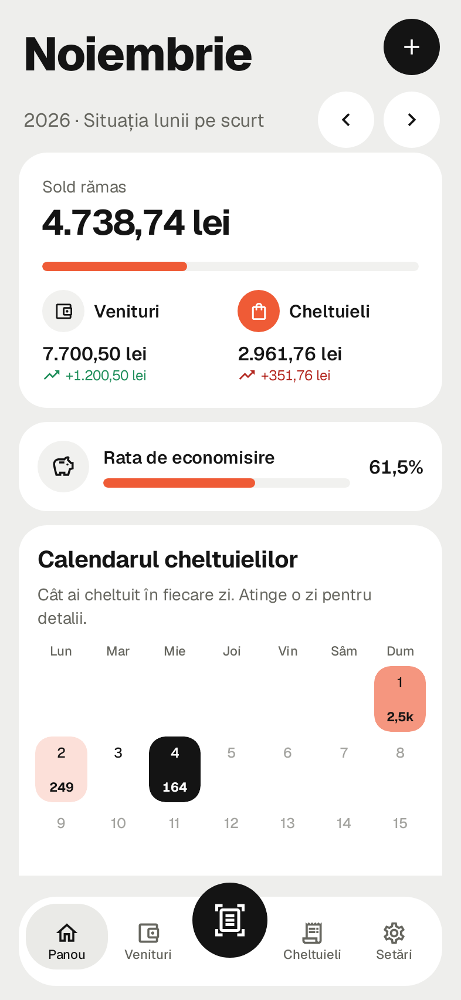
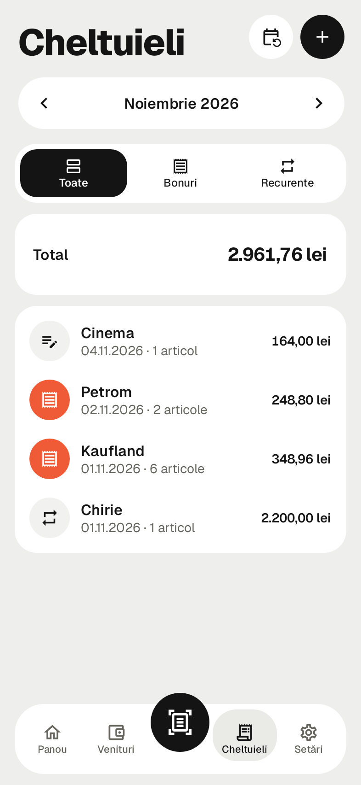
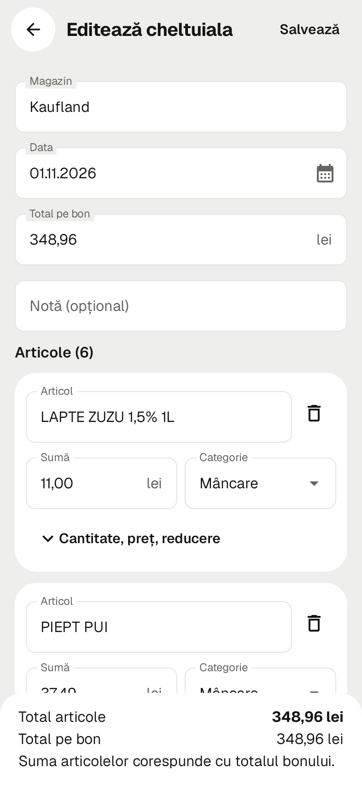
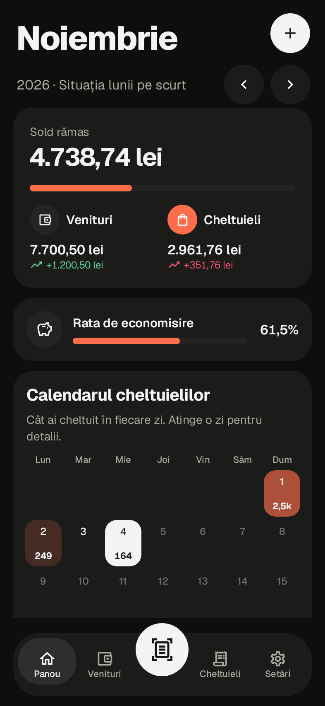

# Punguța cu 2 bani

[](https://github.com/Devisdrago/punguta-cu-2-bani/releases/latest/download/punguta-cu-2-bani.apk)
[](https://github.com/Devisdrago/punguta-cu-2-bani/releases/latest)

<p>
  
  
  
  
</p>

*Screenshots use demo data, rendered by `ScreenshotTest`.*

A private, offline Android app for tracking personal monthly income and spending in RON.
Everything stays on the phone: no accounts, no backend, no cloud sync, no analytics, and no
`INTERNET` permission. The UI is in Romanian; code and comments are in English.

## Features

- **Income**: recurring income (e.g. salary) added automatically on its day each month, plus
  one-time income. Any month's entry can be edited or deleted without touching the template.
- **Navigation**: swipe left or right between the four tabs; a large raised scan button sits in
  the middle of the bottom bar on every tab.
- **Expenses**: manual entry, receipt scanning, and recurring expenses (rent, subscriptions).
  One expense can hold many items, each in its own category.
- **Receipt scanning**: camera or gallery photo, on-device OCR (ML Kit, bundled model), a parser
  for Romanian fiscal receipts, and an editable review screen that highlights uncertain fields and
  warns when the items don't add up to the receipt total. Nothing is saved before you review it.
  The app's own photo copy is deleted after saving or discarding; gallery originals are never
  touched.
- **Categories**: 10 Romanian defaults. You can add, rename and delete them, and items move to a
  category you choose. Categories are suggested on-device by keyword rules, and your corrections
  are remembered and take priority.
- **Dashboard** (one month at a time):
  - a spending calendar: every day shows what you spent, busier days are tinted stronger, and tapping a day lists its expenses
  - income, spending, remaining balance and savings rate
  - spending by category as a donut chart plus a sorted list; tap a category to see its items
  - a 6-month trend chart
  - changes from the previous month
  - monthly category budgets, with warnings at 80% and when exceeded
- **Security and backup**:
  - fingerprint lock with the phone's PIN or pattern as fallback
  - Android auto-backup and device-to-device transfer disabled
  - versioned JSON export and restore through the system file picker; restore is validated first
    and runs in a single transaction

## Install on your phone

**Option A: download on the phone.** Open this page on your phone and tap **Descarcă APK** at the
top, or go to [Releases](https://github.com/Devisdrago/punguta-cu-2-bani/releases/latest). Open
the downloaded `punguta-cu-2-bani.apk`. Android will ask you to allow installing from your browser
the first time. The app isn't on the Play Store, so Play Protect may warn about an unknown app.

**Option B: install with adb.** Enable *Developer options → USB debugging*, connect the phone,
then run:

```
adb install -r punguta-cu-2-bani.apk
```

Requires Android 8.0 (API 26) or newer, on an ARM phone (virtually all phones).

> **Important:** Release APKs are debug builds, signed with the author's local debug key.
> Updates install over the old version only if they are signed with the same key. If that key is
> lost, you must uninstall the app, and uninstalling deletes its data. **Export a backup before
> uninstalling or reinstalling.**

## Build from source

Requirements: JDK 17 and the Android SDK (platform 35, build-tools 35). `local.properties` must
point `sdk.dir` at the SDK.

```
gradlew assembleDebug        # build the APK
gradlew testDebugUnitTest    # run all unit tests (JVM + Robolectric, no device needed)
gradlew lintDebug            # static checks
```

If Gradle fails on Windows with "Unable to establish loopback connection", point Java's socket
temp folder somewhere simple, e.g. `JAVA_TOOL_OPTIONS=-Djdk.net.unixdomain.tmpdir=C:\jdktmp`.

## Design

The look follows a soft-grey, white-card style: a bold Geist headline, black pill buttons, one coral
accent and a floating pill navigation bar. Tokens and components are documented in [DESIGN.md](DESIGN.md).

## Architecture

```
app/src/main/java/ro/punguta/app/
  domain/      Pure Kotlin, no Android: money, receipt parser, recurrence rules, category
               suggestions, dashboard math, budgets, backup format and validation
  data/        Room database (entities, DAOs, migrations), repositories, OCR adapter, photo storage
  ui/          Compose screens and ViewModels (MVVM), one package per feature
  security/    App lock and biometric prompt
  work/        WorkManager job for recurring entries
```

Design decisions:

- **Money** is always a `Long` number of bani; there is no floating point in stored amounts or
  calculations. Floats are used only to draw charts.
- **Duplicate prevention for recurring entries**:
  - Each generated (template, month) pair is recorded in `recurring_generation_log` inside the
    same transaction that creates the entry.
  - The entry tables also have a unique `(templateId, period)` index.
  - Catch-up runs every time the app comes to the foreground and once a day through WorkManager.
  - A deleted generated entry is not recreated.
- **Room migrations**: the schema is exported to `app/schemas/`. `AppDatabase.MIGRATIONS` must get
  a new `Migration` for every version bump, and destructive fallback is never enabled. A test fails
  if a version step is missing.
- **INTERNET permission**: ML Kit's usage-reporting dependency adds `INTERNET` and
  `ACCESS_NETWORK_STATE`. Both are removed in `AndroidManifest.xml` with `tools:node="remove"`. The
  bundled OCR model needs neither. The final merged manifest was checked: the app's permissions
  are `CAMERA`, `USE_BIOMETRIC` / `USE_FINGERPRINT`, and WorkManager's `WAKE_LOCK`,
  `RECEIVE_BOOT_COMPLETED` and `FOREGROUND_SERVICE`.
- **No logging** of financial data or receipt text. The code contains no `Log`, `println` or
  `printStackTrace` calls.

## Tests

96 unit tests, all passing, covering:

| Area | Test |
|---|---|
| Receipt parser (9 fixture receipts in `app/src/test/resources/receipts/`, incl. messy OCR) | `ReceiptParserTest`, `RowAssemblerTest`, `ReceiptFormMapperTest` |
| Money parsing/formatting, savings rate | `MoneyTest` |
| Monthly totals, comparisons, trends | `DashboardCalculatorTest` |
| Category rules and learning | `CategorySuggesterTest`, `CategoryRepositoryTest`, `ExpenseRepositoryTest` |
| Recurring date rules, catch-up, duplicates, edits, stop/resume | `RecurrenceRulesTest`, `RecurringRepositoryTest` |
| Budgets | `BudgetsTest`, `DashboardCalculatorTest` |
| Backup/restore round trip, validation, rollback on failure | `BackupRepositoryTest` |
| Room schema and migrations | `MigrationTest` |
| App lock | `AppLockTest` |
| Launch app, render every tab, add an expense | `AppSmokeTest` (Robolectric) |
| Render main screens in light and dark to `app/build/screenshots/` | `ScreenshotTest` (Robolectric, native graphics) |

## Known limitations

- **Not run on a real device or emulator.** This PC cannot run the emulator (Windows Hypervisor
  Platform is off). Everything below was verified only by unit tests and Robolectric, which does
  not exercise:
  - the camera, and OCR on real photos
  - the biometric prompt
  - the file pickers
  - the WorkManager schedule
  - real rendering of the charts
- **The receipt parser was tuned on fixture texts written to resemble real ML Kit output**, not on
  output from your actual receipts. Expect to find layouts it misreads. Everything stays editable
  and highlighted, but some receipts will need manual fixes.
- A discount printed after SUBTOTAL (e.g. loyalty-card discount) applies to the whole receipt.
  It is spread over the items in proportion to their amounts, and the review screen says so.
- Budgets are one monthly limit per category, applied to every month, and are only shown on the
  dashboard (no notifications).
- If Android kills the app while a scanned receipt is under review, that unsaved review is lost.
  The photo copy is cleaned up on the next start.
- Backup files are not encrypted, and restore replaces all data (no merging).
- A recurring template's start date cannot be changed after creation, so an edit can't backfill
  past months. Resuming a stopped template does not backfill the months it was stopped.
- The app does not set `FLAG_SECURE`, so a screenshot of the last screen can appear in the
  recent-apps view.
- Dependencies are pinned to stable versions known to work together. Lint reports newer versions
  are available; updating them is optional and should be tested.
